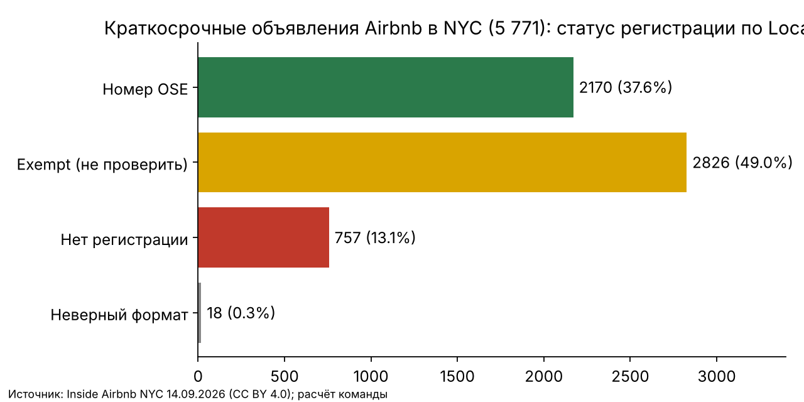
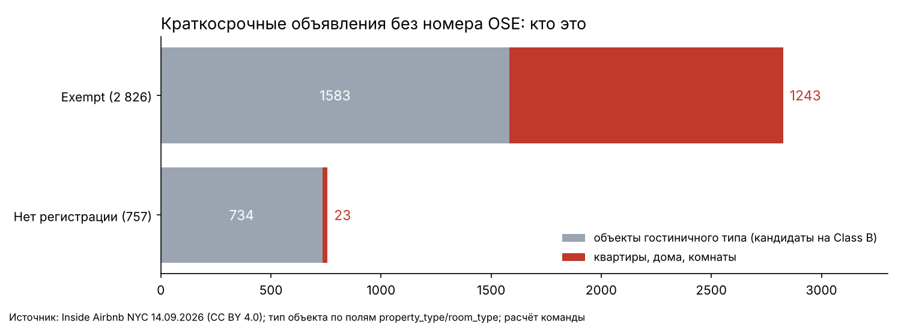

# 1. Диагностика и целеполагание. 2.1. Планирование и сбор данных

Автор: Артём Конышев (бизнес-аналитик команды)

Оговорка, которую мы держим через весь отчёт: внутренних данных Airbnb у нас нет. Вместо них мы используем два открытых набора: публичную копию объявлений Inside Airbnb и официальный реестр регистраций OSE. Внутренние системы компании описаны только по её публичным материалам, у каждого такого утверждения стоит ссылка.

## 1.1. Текущее состояние

### Компания

Airbnb работает как двусторонняя площадка: хосты выставляют жильё, гости бронируют, компания зарабатывает на сервисных сборах, а выручку признаёт в момент заезда [источник: https://sec-api.io/insights/airbnb-abnb-q3-2026-earnings-sec-filing-analysis-nights-up-16-gbv-27-7bn-and-a-new-12bn-buyback]. По итогам 2025 года выручка составила $12,24 млрд, чистая прибыль $2,51 млрд [источник: 10-K FY2025, сводка https://app.edgar.tools/companies/ABNB]. За год через платформу забронировали 533 млн ночей и мест, объём бронирований (GBV) достиг $91,3 млрд; на Северную Америку пришлось $5,20 млрд выручки [источник: https://sec-api.io/insights/airbnb-abnb-q3-2026-earnings-sec-filing-analysis-nights-up-16-gbv-27-7bn-and-a-new-12bn-buyback]. Хостов больше 5 млн, гостей они приняли больше 2,5 млрд раз с 2007 года [источник: пресс-релиз Airbnb о результатах 2025 г., https://www.itiger.com/news/2611977231].

Ни один город не даёт больше 2% выручки [источник: там же, sec-api.io]. Значение Нью-Йорка в другом: здесь платформа впервые в таком масштабе обязана проверять каждое объявление по государственному реестру до того, как примет оплату.

### Требование регулятора: Local Law 18

Закон приняли 9 января 2022 года [источник: https://www.nyc.gov/site/specialenforcement/registration-law/registration.page]. Хост, который сдаёт жильё меньше чем на 30 ночей, обязан зарегистрироваться в Office of Special Enforcement (OSE) и указать номер в объявлении. Платформа не имеет права проводить оплату, пока не проверит через электронную систему OSE, что объявление зарегистрировано или законно освобождено [источник: https://www.nyc.gov/site/specialenforcement/registration-law/enforcement.page]. Освобождены аренда от 30 ночей и объекты в зданиях Class B, одобренных городом для краткосрочного проживания, то есть в основном гостиницы [источник: https://www.nyc.gov/site/specialenforcement/registration-law/registration.page]. В справке Airbnb прямо сказано, что исключение Class B в объявлении могут заявлять только традиционные средства размещения (гостиницы) [источник: https://www.airbnb.com/help/article/868/new-york--ny]. Проверка платформами действует с 5 сентября 2023 года; иск Airbnb против закона суд отклонил 9 августа 2023 года [источник: https://coleschotz.com/?p=10292].

Что изменилось после 2023 года, видно по отчётам самого OSE. В начале 2023 года на одной площадке было больше 38 000 активных объявлений, а по годовому отчёту OSE за FY2025 действующих регистраций около 3 000. За последний год OSE одобрил 40% заявок, больше 4 300 заявок не соответствовали требованиям [источник: https://www.nyc.gov/site/specialenforcement/news/new-report-sheds-fresh-light-on-how-local-law-18.page]. По данным OSE, которые приводит QNS, с момента вступления закона в силу одобрено больше 3 500 регистраций, из них 460 в FY2026 [источник: https://qns.com/2026/09/local-law-18-queens-lose-100-million-income/]. В скачанном нами реестре на 02.11.2026 3 842 записи, из них 3 439 со статусом Registered, 250 Expired, 131 Terminated и 22 Revoked [данные: data/processed/ose_registrations.csv].

### Что показывают открытые данные

На 14.09.2026 в Нью-Йорке 29 918 объявлений, краткосрочных (минимум меньше 30 ночей) из них 5 771, это 19,3% [данные: data/processed/key_facts.md]. По полю регистрации они делятся так (рис. 1): номер OSE указан у 2 170, «Exempt» у 2 826, ничего нет у 757, у 18 номер записан в неверном формате [данные: data/processed/key_facts.md].

Номера OSE в объявлениях в целом честные: все 2 170 нашлись в реестре, но у 13 статус уже не Registered (10 Expired, 3 Terminated) [данные: data/processed/listings_clean.csv, ose_registrations.csv; расчёт scripts/artem_section1.py].

Серьёзнее выглядят две другие группы, и мы разобрали их по типу объекта (рис. 2). Из 757 объявлений без регистрации 734 относятся к гостиничному типу: «Room in hotel» и похожие. Скорее всего, это гостиницы с правом на исключение Class B, у которых статус просто не выведен в объявление. Квартир, домов и комнат без регистрации всего 23 [данные: listings_clean.csv; расчёт scripts/artem_section1.py]. Получается, что M1 в нынешнем виде больше говорит о том, как плохо размечены данные, чем о нарушениях.

С «Exempt» картина обратная. Из 2 826 таких объявлений 1 243 не похожи на гостиницы, и 1 050 из них сдаются целиком (Entire home/apt). У 1 099 есть отзывы за последние 12 месяцев, значит, гости там жили. Принадлежат эти объявления 384 хостам, 949 из них находятся в Манхэттене [данные: listings_clean.csv; расчёт scripts/artem_section1.py]. По модельной оценке Inside Airbnb их выручка за год около $110 млн (оценка есть для 1 150 объявлений) [данные: поле estimated_revenue_l365d в listings_clean.csv]. Если исключение может заявлять только гостиница, эти 1 243 объявления и есть главная зона риска для Airbnb.

Ограничение анализа: OSE проверяет объявление в момент оплаты, а Inside Airbnb видит только витрину. Мы не знаем, сколько бронирований система Airbnb заблокировала. Поэтому всё сказанное выше описывает качество данных объявлений. Доказанными нарушениями закона это считать нельзя.

### Зрелость работы с данными

По шкале курса (оцифровка → автоматизация → цифровизация → цифровая трансформация) Airbnb в целом стоит на последней ступени. Компания сама создала инструменты, которыми пользуется вся отрасль. Apache Airflow (оркестрация конвейеров данных) появился в Airbnb [источник: https://en.wikipedia.org/wiki/Apache_Airflow], там же начинался Apache Superset (BI и визуализация) [источник: https://en.wikipedia.org/wiki/Apache_Superset]. Внутри работают каталог данных Dataportal и платформа метрик Minerva, которая даёт одни и те же определения метрик в дашбордах, A/B-тестах и поиске аномалий [источник: https://medium.com/airbnb-engineering/how-airbnb-achieved-metric-consistency-at-scale-f23cc53dea70]. В 2023 году каталог вырос в платформу управления данными Metis [источник: https://medium.com/airbnb-engineering/data/home].

С данными о соблюдении LL18 в Нью-Йорке дела хуже. Проверка через API OSE автоматизирована, а поле статуса регистрации в открытой витрине фактически остаётся свободным заявлением хоста. «Exempt» никак не привязан к списку Class B, гостиницы и квартиры размечены одинаково, номера в нижнем регистре проходят как отдельное значение. Мы оцениваем этот участок между автоматизацией и цифровизацией: процесс проверки есть, но данные на входе не управляются.

### Культура данных по шести измерениям

Оценки по шкале 1–5 поставила команда по публичным фактам, так что это суждение команды.

| Измерение | Что известно публично | Оценка |
|---|---|---|
| Data Leadership | С 2019 г. в Airbnb идёт программа качества данных, есть группа руководителей дата-инжиниринга, отвечающая за оргрешения и найм [источник: https://oreil.ly/cfrcJ]. При этом в 10-K компания пишет, что оспаривает регулирование, «неоправданно ограничивающее право сдавать жильё» [источник: 10-K FY2025, https://fortune.com/company-assets/2512/quartr/annual-report-10-k-dca2b-2026-02-12-09-38-05.pdf] | 4 |
| Data Strategy | Регулирование названо в 10-K среди факторов риска для роста выручки [источник: https://www.tradingview.com/news/tradingview:c03a1a2a8e50a:0-airbnb-inc-sec-10-k-report/]. Отдельной публичной стратегии данных о соблюдении правил мы не нашли | 3 |
| Data Governance | У каждого важного набора данных есть владелец, таблицы сгруппированы по предметным областям; наборы проходят сертификацию Midas (согласование спецификации, проверка данных и кода) [источник: https://oreil.ly/cfrcJ] | 4 |
| Data Access | Self-service BI на Superset, каталог Dataportal, доступ к метрикам через API Minerva [источник: https://medium.com/airbnb-engineering/supercharging-apache-superset-b1a2393278bd] | 5 |
| Data Literacy | Внутренняя программа Data University; в 2017 г. 45% сотрудников еженедельно пользовались дата-платформой [источник: https://medium.com/airbnb-engineering/3eccc71e073a] | 4 |
| Data Communication | Единые определения метрик в Minerva [источник: medium.com/airbnb-engineering, Minerva], ежемесячный форум дата-инженеров и еженедельный разбор критичных багов качества [источник: https://oreil.ly/cfrcJ] | 4 |

Слабее всего стратегия и лидерство именно в части комплаенса. Инженерная культура сильная, но данные для регулятора компания долго воспринимала как навязанную внешнюю обязанность. Это видно и по позиции в суде, и по тому, как размечены объявления.

## 1.2. SMART-цель

Главная цель (M1): к 30.06.2027 снизить долю краткосрочных объявлений Airbnb в Нью-Йорке без регистрации и без подтверждённого исключения с 13,1% до 0,5% и меньше.

| Буква | Как выполняется |
|---|---|
| S, конкретная | Одна метрика, один город, одна совокупность: объявления с минимальным сроком меньше 30 ночей |
| M, измеримая | Считается кодом по открытым данным: 757 из 5 771 сейчас [данные: key_facts.md]; внутри Airbnb та же метрика берётся из базы объявлений и журнала проверок API OSE |
| A, достижимая | Из 757 объявлений 734 гостиничного типа и закрываются разметкой Class B по списку OSE; по-настоящему спорных объявлений 23 [данные: расчёт scripts/artem_section1.py]. Порог 0,5% от 5 771 означает не больше 28 объявлений |
| R, релевантная | За обработку оплаты по незарегистрированному объявлению закон предусматривает штрафы для платформы [источник: https://www.nyc.gov/site/specialenforcement/registration-law/enforcement.page]; ЕС с 20.05.2026 требует того же по всем странам союза (см. бенчмарки) |
| T, ограниченная по времени | 30.06.2027, промежуточная проверка 31.03.2027 вместе с M2 и M4 |

Все метрики проекта (ID общие для всей команды):

| ID | Метрика | Baseline | Цель команды | Срок |
|---|---|---|---|---|
| M1 | Доля краткосрочных объявлений без регистрации и без исключения | 13,1% (757 из 5 771) [данные: key_facts.md] | ≤ 0,5% (цель команды) | 30.06.2027 |
| M2 | Доля краткосрочных объявлений с неподтверждённым «Exempt» | 49,0% (2 826) [данные: key_facts.md] | 0% неподтверждённых (цель команды) | 31.03.2027 |
| M3 | Объявления с недействующей регистрацией (Expired/Terminated) | 13 из 2 170 (0,6%) [данные: key_facts.md] | 0, снятие с публикации ≤ 24 ч (цель команды) | постоянно |
| M4 | Полнота цены в объявлениях | 64,9% [данные: quality_report.md] | ≥ 98% (цель команды) | 31.03.2027 |
| M5 | Доля активных объявлений (последний отзыв ≤ 12 мес., из имеющих отзывы) | 48,9% [данные: quality_report.md] | ≥ 80%, неактивные на перепроверку или в архив (цель команды) | 30.06.2027 |

Для M2 мы предлагаем начать с 1 243 негостиничных «Exempt»: это 44% группы, и именно они противоречат правилам самой Airbnb [данные: расчёт scripts/artem_section1.py].

### Бенчмарки

Нью-Йорк. После запуска проверки рынок сжался примерно с 38 000 активных объявлений на одной площадке до около 3 000 действующих регистраций [источник: https://www.nyc.gov/site/specialenforcement/news/new-report-sheds-fresh-light-on-how-local-law-18.page]. Значит, требование «нет номера, нет оплаты» исполнимо технически, и целевой уровень M1, близкий к нулю, реалистичен.

Испания. С июля 2025 года действует национальный реестр краткосрочной аренды с обязательным номером в объявлении [источник: https://shorttermrentalz.com/news/spain-fines-airbnb-e64-million-over-unlicensed-short-term-rental-listings/]. В декабре 2025 года министерство по делам потребителей оштрафовало Airbnb на €64 млн за 65 122 объявления без лицензии или с номером, не совпадающим с реестром [источник: https://www.malaymail.com/news/money/2025/12/16/spain-fines-airbnb-64m-for-advertising-banned-rental-properties/202135]. Airbnb ответила, что с января больше 70 000 объявлений добавили номер регистрации [источник: там же]. Для нас это прямой урок: неверный или непроверенный номер наказывается так же, как отсутствие номера. Поэтому M2 и M3 стоят в одном ряду с M1.

Европейский союз. Регламент (ЕС) 2024/1028 применяется с 20 мая 2026 года: платформа обязана собирать номер регистрации по каждому объявлению, показывать его, выборочно сверять с национальным реестром и приостанавливать или снимать объявления с недействительным номером [источник: https://mcs.pt/eu-regulation-2024-1028-on-short-term-rentals-enters-into-application-on-20-may-2026-what-changes-for-alojamento-local-platforms-and-hosts/]. Контроль, который мы предлагаем для Нью-Йорка, Airbnb всё равно придётся строить для Европы, где у компании $4,73 млрд выручки [источник: sec-api.io, см. выше]. Решение для NYC можно сделать пилотом.

## 2.1. Планирование и сбор данных

### План управления данными (DMP)

Сроки хранения и роли ниже предлагает команда; внутренние регламенты Airbnb нам неизвестны.

| Данные | Зачем | Ответственный | Где хранятся | Сколько хранить |
|---|---|---|---|---|
| Объявления NYC: тип объекта, минимальный срок, статус регистрации, цена (I1) | Расчёт M1–M5, проверка до публикации | Data Owner: руководитель продукта «Объявления»; Data Steward по NYC | Операционная БД объявлений → витрины D1, D2 | Пока объявление активно + 3 года (цель команды) |
| Журнал проверок API OSE: номер, ответ, время (I4) | Доказательство проверки перед регулятором, M1 и M3 | Комплаенс (юристы) | Отдельный защищённый журнал, только добавление записей | 6 лет (цель команды) |
| Бронирования и платежи по NYC (I2) | Проверка, что оплата не прошла без валидной регистрации | Финансы | DWH, агрегаты в D1 | По требованиям учёта; агрегаты 6 лет (цель команды) |
| Верификация хостов (I3) | Связать хоста с регистрацией и документом об исключении | Trust & Safety | Защищённое хранилище, доступ по ролям | Пока аккаунт активен (цель команды) |
| Реестр OSE и список Class B (S2) | Эталон для сверки номеров и исключений | Data Steward по NYC | Справочник (reference data), ежедневное обновление | Все версии снимков (цель команды) |
| Inside Airbnb (S1, S3) | Внешний аудит: смотрим на витрину глазами регулятора | Команда CDO | Репозиторий проекта, `data/raw` | На время проекта; лицензия CC BY 4.0 |

Персональные данные хостов (имя, фото, описание, местоположение хоста) мы при очистке удалили, хотя Inside Airbnb их публикует [данные: data/processed/quality_report.md]. Это минимизация данных: для расчёта метрик они не нужны.

### Источники

| ID | Источник | Тип | Что берём | Основание |
|---|---|---|---|---|
| S1 | Inside Airbnb NYC, снимок 14.09.2026 | Внешний, открытый, CC BY 4.0 | 29 918 объявлений, 90 полей | [данные: data/README.md] |
| S2 | Реестр регистраций OSE, 02.11.2026 | Внешний, открытые гос. данные | 3 842 регистрации, статус, срок, боро | [данные: data/README.md] |
| S3 | Границы районов Inside Airbnb | Внешний, открытый, CC BY 4.0 | Боро и районы для витрин | [данные: data/README.md] |
| I1 | База объявлений Airbnb | Внутренний | Адрес объявления (должен точно совпадать с адресом в списке OSE) и данные регистрации | [источник: https://www.airbnb.com/help/article/868/new-york--ny] |
| I2 | Бронирования и платежи | Внутренний | Даты, число ночей, сумма; выручка признаётся при заезде | [источник: sec-api.io, см. 1.1] |
| I3 | Верификация хостов | Внутренний | Подтверждённая личность хоста; в открытой витрине флаг стоит у 98,9% краткосрочных объявлений (5 705 из 5 771) | [данные: поле host_identity_verified в listings_clean.csv] |
| I4 | Интеграция с API OSE | Внутренний | Ответ системы проверки по каждому объявлению; ПО OSE строил вместе с платформами | [источник: https://www.nyc.gov/site/specialenforcement/registration-law/enforcement.page] |

Открытые данные мы загружаем автоматически через GitHub Actions (`.github/workflows/fetch-data.yml`), так что сбор повторяем и одним запуском обновляем снимок [данные: data/README.md].

### Методы сбора

Количественные данные: поля объявления (минимальный срок, номер регистрации, тип объекта, цена, координаты), записи о бронированиях и платежах, ответы API OSE, статусы из реестра. Всё это структурированные поля, их можно проверять правилами автоматически.

Качественные данные: тексты описаний и отзывы. В описании хост может написать «hotel» или «только от 30 ночей», и такие слова помогут найти неверную разметку типа объекта. Отзывы показывают, что объект реально сдаётся: у 1 099 негостиничных «Exempt» они есть за последний год [данные: расчёт scripts/artem_section1.py]. Описания из рабочего набора мы убрали ради минимизации, поэтому текстовый анализ мы только предлагаем внутренней команде Airbnb и сами его не делали.

### Контроль качества до ввода (Pre-Entry Quality Control)

Идея простая: плохое значение дешевле не пустить в форму, чем потом искать в базе. Для формы объявления в Нью-Йорке предлагаем шесть правил.

| № | Правило | Что сейчас в данных | Какую метрику двигает |
|---|---|---|---|
| П1 | Если минимальный срок меньше 30 ночей, поле статуса обязательно; варианты только из списка: номер OSE, гостиница Class B. Свободного «Exempt» нет | 757 пустых, 2 826 «Exempt» [данные: key_facts.md] | M1, M2 |
| П2 | Маска `OSE-STRREG-` + 7 цифр; перед проверкой форма убирает пробелы и переводит буквы в верхний регистр | 18 номеров в неверном формате; у всех 18 ошибка только в регистре букв, после исправления все находятся в реестре [данные: расчёт scripts/artem_section1.py] | M1 |
| П3 | Номер проверяется через API OSE до публикации: статус Registered, адрес совпадает. Затем ежедневная перепроверка, при Expired или Terminated объявление снимается | 13 номеров с недействующим статусом [данные: key_facts.md] | M3 |
| П4 | Class B принимается, только если адрес есть в списке Class B Multiple Dwellings у OSE | 1 243 негостиничных «Exempt», 1 050 из них сдаются целиком [данные: расчёт scripts/artem_section1.py] | M2 |
| П5 | Если один номер указан в нескольких объявлениях, запрос подтверждения у хоста и отметка Data Steward | 241 номер встречается в 2+ объявлениях (538 объявлений, до 6 на номер) [данные: расчёт scripts/artem_section1.py] | M1, M3 |
| П6 | Цена обязательна, допустимый диапазон $10–10 000 | Цена заполнена у 64,9% всех объявлений и у 89,0% краткосрочных; 10 цен вне диапазона [данные: quality_report.md; расчёт scripts/artem_section1.py] | M4 |

П5 только сигналит: по одной регистрации хост может законно выставлять, например, разные комнаты одной квартиры. Решение о нарушении принимает человек (human-in-the-loop, подробнее у Гоши в разделе 4).

Как данные после ввода очищаются, проверяются и хранятся, описывает Женя в разделах 2.2 и 2.3.

---
Расчёты: `scripts/artem_section1.py` (запуск из корня репозитория). Новый график: `data/charts/4_exempt_hotel_split.png`.
