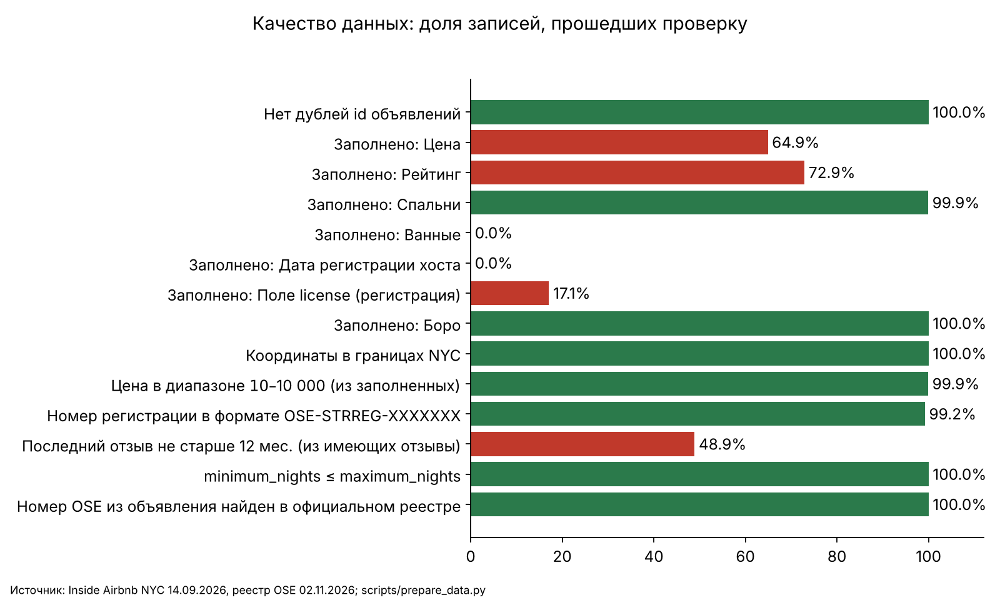

# 2.2. Обработка и анализ. 2.3. Хранение, обмен, завершение цикла. 5. Логическая модель и план

Автор: Женя (аналитик данных команды)

Артём в разделах 1 и 2.1 показал, откуда берутся данные и какие правила ставятся на входе. Здесь описано, что происходит с данными дальше: как мы их очистили и проверили, где их хранить и как из проверок получаются решения. Оговорка та же: внутренних данных Airbnb у нас нет, все цифры посчитаны по открытым наборам S1 и S2.

## 2.2. Обработка и анализ

### Что сделано при очистке

Очистку выполняет один скрипт, `scripts/prepare_data.py`. Его можно перезапустить и получить те же цифры. Шагов четыре.

1. **Дубли.** Проверили уникальность идентификатора объявления: из 29 918 строк повторов нет [данные: data/processed/quality_checks.csv].
2. **Цена как число.** В исходнике цена записана текстом вида `$1,234.00`. Убрали знак доллара и запятые, получили числовое поле `price_num` [данные: scripts/prepare_data.py].
3. **Минимизация.** Удалили 10 полей с персональными данными хостов: имя, фото, описание хоста, его местоположение, тексты объявления. В реестре OSE убрали улицу и номер квартиры, оставили боро, индекс и номер здания [данные: data/processed/quality_report.md; scripts/prepare_data.py]. Для расчёта M1–M5 эти поля не нужны.
4. **Разметка.** Добавили два признака: `short_term` (минимальный срок меньше 30 ночей) и `lic_type` (нет / Exempt / номер OSE / другое). Реестр OSE пришёл в Excel со «склеенными» строками, его развернули в две таблицы: регистрации и связи «регистрация → объявление» [данные: data/README.md].

### Валидация и верификация

Это разные проверки. **Валидация** отвечает на вопрос «значение записано по правилам?» и делается без внешних источников. **Верификация** отвечает на вопрос «значение соответствует действительности?» и требует сверки с эталоном, у нас это реестр OSE.

| Проверка | Тип | Результат | Источник |
|---|---|---|---|
| Номер в формате `OSE-STRREG-` + 7 цифр | Валидация | 2 170 из 2 188 краткосрочных, 99,2%. Все 18 ошибок только в регистре букв | [данные: расчёт scripts/zhenya_section2.py] |
| Координаты в границах Нью-Йорка | Валидация | 100% | [данные: quality_checks.csv] |
| Цена в диапазоне $10–10 000 | Валидация | 99,9%; 10 цен выше, максимум $31 538 | [данные: quality_checks.csv; расчёт scripts/zhenya_section2.py] |
| Номер найден в реестре OSE | Верификация | 2 170 из 2 170, 100% | [данные: quality_checks.csv] |
| Номер в реестре привязан к этому же объявлению | Верификация | 2 170 из 2 170, 100% | [данные: расчёт scripts/zhenya_section2.py] |
| Статус регистрации действующий | Верификация | 2 157 Registered; 10 Expired, 3 Terminated | [данные: расчёт scripts/zhenya_section2.py] |
| «Exempt» подтверждён | Верификация | Проверить нечем: 2 826 объявлений, 49,0% | [данные: key_facts.md] |

Главный вывод раздела: **номера OSE проходят и валидацию, и верификацию почти без потерь, а «Exempt» не проходит ни одну из них.** Это слово хост вписывает сам. Правила формата для него нет, открытого эталона для сверки тоже нет: список зданий Class B в наших данных отсутствует. Половина краткосрочных объявлений держится на непроверяемом заявлении. Поэтому M2 для совета директоров важнее, чем кажется по названию: это самый большой непроверенный участок данных.

Второй вывод касается 13 недействующих номеров. Валидацию они проходят, формат у них верный. Ловит их только верификация, причём повторная: регистрация истекает со временем, и разовой проверки при публикации мало (M3).

### Характеристики качества



| Характеристика | Проверка | Результат | Что это значит для бизнеса |
|---|---|---|---|
| Полнота | Цена заполнена | 64,9% всех объявлений, 89,0% краткосрочных | Без цены нельзя оценить выручку под риском. M4 считается по всем объявлениям, у краткосрочных разрыв до цели 98% меньше |
| Полнота | Статус регистрации заполнен у краткосрочных | 86,9% (пусто у 757) | Это M1. Из 757 пустых 734 гостиничного типа (расчёт Артёма), то есть дефект разметки, а не обязательно нарушение |
| Валидность | Формат номера OSE | 99,2% | Ошибка только в регистре букв, лечится автоприведением в форме (правило П2) |
| Точность | Сверка номера и статуса с реестром | 100% найдено, 0,6% недействующих | Указанным номерам можно доверять; нужна ежедневная перепроверка статуса (П3, M3) |
| Актуальность | Последний отзыв не старше 12 мес. | 48,9% из 21 804 объявлений с отзывами; у 32,7% отзыв старше 3 лет | Половина витрины выглядит неактивной. Это M5: неактивные объявления на перепроверку или в архив |
| Непротиворечивость | Минимальный срок ≤ максимального | 100% | Поле срока надёжно, а на нём держится разметка «краткосрочное» |
| Непротиворечивость | Один номер на нескольких объявлениях | 241 номер из 1 873 | Может быть законно (разные комнаты одной квартиры), но требует просмотра человеком (П5) |
| Уникальность | Дубли идентификатора | 0 | Каждое объявление считается один раз |

Источники для таблицы: [данные: quality_checks.csv; расчёт scripts/zhenya_section2.py; расчёт scripts/artem_section1.py].

Три оговорки к этим цифрам.

- Поля «ванные» и «дата регистрации хоста» в отчёте о качестве показывают 0% заполнения. Они пустые уже в исходном файле Inside Airbnb, наша очистка их не трогала [данные: data/README.md].
- Актуальность сильно зависит от совокупности. Среди краткосрочных объявлений с отзывами свежий отзыв есть у 89,8% [данные: расчёт scripts/zhenya_section2.py]. Низкие 48,9% дают в основном объявления от 30 ночей, где гости меняются редко. M5 оставляем как в общем скелете, но при настройке мониторинга эти две группы стоит разделить.
- Снимок объявлений сделан 14.09.2026, реестр скачан 02.11.2026, разница 49 дней [данные: data/README.md]. Часть из 13 «недействующих» номеров могла быть действующей на дату снимка. Внутри Airbnb сверка должна идти день в день.

## 2.3. Хранение, обмен, завершение цикла

### Тип хранилища

Для инициативы предлагаем схему курса: озеро данных с тремя слоями, над ним хранилище и витрины. Строить её с нуля не нужно, она ложится на то, что у Airbnb уже есть. По публикациям инженерного блога, хранилище компании лежит в объектном хранилище S3, запросы к нему идут через Spark, Trino и Hive, а таблицы переводятся на формат Apache Iceberg [источник: https://medium.com/airbnb-engineering/upgrading-data-warehouse-infrastructure-at-airbnb-a4e18f09b6d5]. Важные наборы проходят сертификацию Midas: у каждого есть владелец от дата-инженеров и от аналитиков [источник: https://medium.com/airbnb-engineering/data-quality-at-airbnb-870d03080469]. Каталог Metis показывает оценку качества каждого набора и его происхождение [источник: https://medium.com/airbnb-engineering/metis-building-airbnbs-next-generation-data-management-platform-d2c5219edf19].

Почему не одно только озеро и не одно только хранилище:

| Слой | Что лежит | Зачем нужен именно он |
|---|---|---|
| Озеро, сырой слой | Ежедневные снимки реестра OSE и списка Class B, ответы API OSE, выгрузка объявлений NYC как есть | Регулятор может спросить, что мы знали на конкретную дату. Сырые данные не изменяются |
| Озеро, очищенный слой | Те же данные после очистки из раздела 2.2: типы, дубли, разметка, нормализованные номера | Одна очистка для всех потребителей, а не своя у каждого отдела |
| Хранилище (DWH) | Таблицы «объявление», «регистрация», «проверка», «бронирование» со связями по номеру и идентификатору | Единый источник правды для M1–M5: юристы и продукт видят одни и те же числа |
| Витрины D1–D3 | Готовые срезы под роль | Каждый видит только нужное и только разрешённое |

Наш репозиторий повторяет эту схему в миниатюре: `data/raw` это сырой слой, `data/processed/listings_clean.csv` очищенный, `key_facts.md` и графики играют роль витрины.

### Схема: от источников до решений

```
Источники              Озеро данных           Хранилище        Витрины            Решения
S1 Inside Airbnb  ─┐                                         ┌─ D1 Соответствие ─ юристы, комплаенс:
S2 Реестр OSE     ─┤   сырой ─► очищенный ─►  DWH: единые  ──┤    LL18 (M1–M3)    снять объявление, запросить документ
S3 Границы        ─┤   слой     слой          таблицы и     ├─ D2 Качество     ─ Data Steward:
I1 Объявления     ─┤                          метрики       │    данных (M4, M5)  исправить поле, отправить в архив
I2 Бронирования   ─┤                                         └─ D3 Сводка       ─ совет директоров:
I3 Верификация    ─┤                                              (M1–M5)         ресурсы, сроки, приоритеты
I4 API OSE        ─┘
```

| Витрина | Кто смотрит | Что видит | Чего не видит |
|---|---|---|---|
| D1 | Юристы, комплаенс | Каждое объявление NYC со статусом проверки, журнал ответов API | Платёжные данные гостей |
| D2 | Data Steward по NYC, продукт «Объявления» | Доли заполнения и ошибок по полям, списки на исправление | Персональные данные хостов сверх идентификатора |
| D3 | Совет директоров, CDO | Пять чисел M1–M5, динамика, светофор | Отдельные объявления и хостов |

### Обмен и завершение цикла

**Обмен.** Наружу уходят два потока: ответы регулятору (из D1, по запросу OSE) и наш открытый репозиторий с обезличенными данными и кодом. Внутри компании обмен идёт через витрины, а не пересылкой выгрузок.

**Архив и удаление.** Опираемся на сроки из плана управления данными Артёма (2.1); это предложения команды.

| Данные | Что делаем | Когда |
|---|---|---|
| Журнал проверок API OSE | Архив, только чтение | Хранить 6 лет (цель команды) |
| Снимки реестра OSE и Class B | Архив всех версий | Бессрочно: это эталон на дату |
| Неактивные объявления (нет отзывов больше 12 мес.) | Запрос хосту на подтверждение; без ответа снимаем с витрины и переносим в архив | Ежеквартально; связь с M5 |
| Архивные объявления | Удаление персональных полей, остаётся обезличенная запись для статистики | Через 3 года после снятия (цель команды) |
| Сырые копии Inside Airbnb | Удаление из рабочей среды, остаётся ссылка на источник и дата | По завершении проекта |

Сейчас у 11 131 объявления из 21 804 с отзывами последний отзыв старше года [данные: quality_checks.csv]. Это и есть объём первой перепроверки по M5.

### FAIR

| Принцип | Как у нас в репозитории | Что предлагаем Airbnb |
|---|---|---|
| Findable, находимость | Постоянный адрес репозитория, `data/README.md` с таблицей источников, в именах файлов источник и дата | Наборы NYC зарегистрировать в каталоге Metis с владельцем и описанием |
| Accessible, доступность | Скачивание по HTTPS через GitHub; доступ по приглашению участникам | Доступ к D1–D3 по ролям через существующие инструменты, без выгрузок в файлы |
| Interoperable, совместимость | Открытые форматы CSV, GeoJSON, Markdown; номер OSE как общий ключ между S1 и S2 | Единый формат номера (П2) и общий справочник статусов OSE во всех таблицах |
| Reusable, повторное использование | Указаны лицензии (CC BY 4.0 для S1 и S3), дата каждого снимка, скрипты очистки и расчётов лежат рядом с данными | Для каждой метрики хранить код расчёта и версию данных, чтобы цифру можно было воспроизвести для регулятора |

Слабое место по FAIR у нас одно: реестр OSE публикуется только файлом Excel и без явной лицензии. Подробнее об этом у Гоши в разделе 3.2.

## 5. Логическая модель и план

### 5.1. Логическая модель

| Звено | Содержание |
|---|---|
| **Ресурсы** | Данные: S1–S3 (открытые), I1–I4 (внутренние). Люди: команда CDO, Data Steward по NYC, юристы, разработчики формы объявления. Инфраструктура: существующее хранилище, каталог, конвейеры Airflow. Время: до 30.06.2027 |
| **Мероприятия** | 1) Аудит открытых данных (сделан в этом отчёте). 2) Шесть правил контроля на входе П1–П6. 3) Ежедневная сверка номеров и статусов с реестром OSE. 4) Подключение списка Class B и перепроверка всех «Exempt». 5) Ежеквартальная перепроверка неактивных объявлений. 6) Сборка витрин D1–D3 |
| **Результаты** (измеримые) | Проверено 5 771 краткосрочное объявление: 2 170 номеров сверено с реестром, найдено 13 недействующих, 18 в неверном формате, 757 без статуса, 2 826 «Exempt» [данные: key_facts.md]. Выполнено 14 проверок качества [данные: quality_checks.csv]. Опубликован воспроизводимый репозиторий. К внедрению: П1–П6 в форме объявления, витрины D1–D3, журнал проверок |
| **Эффекты, краткосрочные** (до 31.03.2027) | M2: 0% неподтверждённых «Exempt». M4: цена заполнена у ≥ 98%. Юристы видят статус каждого объявления в D1 (цели команды) |
| **Эффекты, среднесрочные** (до 30.06.2027) | M1 ≤ 0,5%. M3: 0 недействующих, снятие за ≤ 24 ч. M5 ≥ 80% (цели команды) |
| **Эффекты, долгосрочные** | Нет штрафов по LL18; готовое решение переносится на рынки ЕС, где похожие требования действуют с 20.05.2026 (см. бенчмарки в 1.2) |
| **Воздействие** | Данные для регулятора становятся управляемым активом компании, а не внешней обязанностью; доверие городов к платформе |

Проверка цепочки «если… то…»:

- Если есть доступ к реестру OSE, списку Class B и базе объявлений, то можно ввести правила П1–П6 и ежедневную сверку.
- Если правила и сверка работают, то каждое краткосрочное объявление получает один из проверенных статусов, а результат попадает в витрины D1–D3.
- Если статус виден в витринах, то юристы и Data Steward находят проблемные объявления за день, а не при проверке регулятора.
- Если проблемные объявления находят и исправляют быстро, то M1–M3 идут к нулю, а M4 и M5 к целевым значениям.
- Если метрики держатся на целевом уровне, то исчезает риск штрафов, а решение можно тиражировать на другие города.

Слабое звено цепочки первое: список Class B. В открытых данных, которые мы скачали, его нет, и без него M2 закрыть нельзя. Это надо решить до старта остальных работ.

### 5.2. Мониторинг

| KPI | Витрина | Кто смотрит | Как часто | Порог реакции (цель команды) |
|---|---|---|---|---|
| M1 | D1, D3 | Комплаенс; совет директоров | Ежедневно; раз в квартал | Рост два дня подряд: разбор причин |
| M2 | D1, D3 | Комплаенс, юристы | Еженедельно до 31.03.2027, затем ежедневно | Любой новый неподтверждённый «Exempt» |
| M3 | D1 | Комплаенс | Ежедневно | Любое значение больше 0: снять за 24 ч |
| M4 | D2, D3 | Data Steward, продукт | Еженедельно | Ниже 98% после 31.03.2027 |
| M5 | D2, D3 | Data Steward | Ежемесячно; перепроверка раз в квартал | Ниже 80% после 30.06.2027 |

Как часто запускаются проверки качества:

| Проверка | Частота | Где |
|---|---|---|
| Формат номера, обязательность статуса и цены (П1, П2, П6) | При каждом сохранении объявления | Форма объявления |
| Сверка номера и статуса с API OSE (П3) | До публикации и перед каждой оплатой, плюс ежедневно по всем активным | Конвейер в хранилище, журнал I4 |
| Сверка «Exempt» со списком Class B (П4) | При публикации и при каждом обновлении списка | Конвейер в хранилище |
| Повторы номера (П5) | Ежедневно | D1, список на просмотр человеку |
| Полнота, валидность, актуальность по всем полям | Еженедельно | D2 |
| Внешний аудит по открытым данным (повтор этого отчёта) | Раз в квартал, с каждым новым снимком Inside Airbnb | Репозиторий проекта, `scripts/prepare_data.py` |

Последняя строка нужна, чтобы видеть витрину так, как её видит регулятор. Внутренние метрики могут быть в порядке, а на сайте останется старое значение.

Какие риски несут эти данные и что требует закон, разбирает Гоша в разделах 3 и 4.

---
Расчёты: `scripts/zhenya_section2.py` (запуск из корня репозитория).
