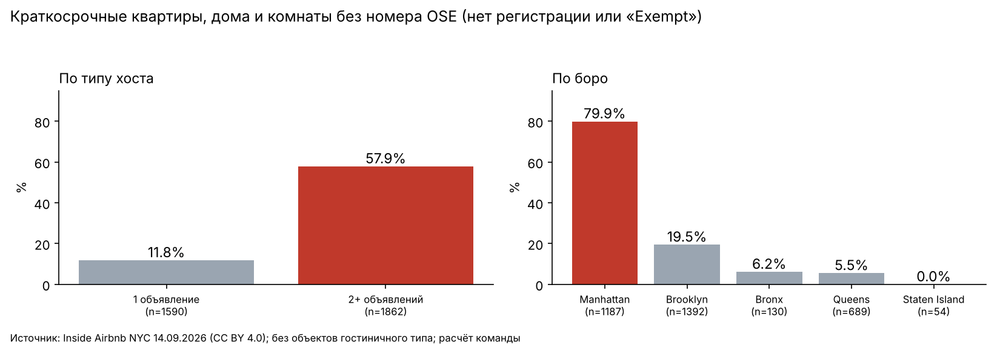

# 3. Аудит открытых данных. 4. Риски, этика, право

Автор: Гоша (риски и комплаенс команды)

Артём поставил цели M1–M5, Женя показал, как данные проверяются и хранятся. Здесь два вопроса: насколько можно доверять открытым данным, на которых стоит весь аудит, и какие этические, правовые и операционные риски несёт предложенная программа. Оговорка прежняя: внутренних данных Airbnb у нас нет.

## 3.1. Открытые датасеты и гипотезы

| ID | Что внутри | Кто публикует | Какую гипотезу проверяет |
|---|---|---|---|
| S1 | 29 918 объявлений Airbnb в Нью-Йорке на 14.09.2026, 90 полей: тип объекта, срок, цена, отзывы, поле регистрации | Inside Airbnb, независимый проект; данные собраны с публичного сайта Airbnb [источник: https://insideairbnb.com/get-the-data/] | «Краткосрочные объявления показывают действующую регистрацию или законное исключение» |
| S2 | 3 842 регистрации: номер, статус, срок, боро, привязанные объявления | Office of Special Enforcement мэрии Нью-Йорка, публикация по LL18 [источник: https://www.nyc.gov/site/specialenforcement/registration-law/registration-and-listing-data.page] | «Номер из объявления существует, действует и выдан именно этому объявлению» |
| S3 | Границы боро и районов | Inside Airbnb | Вспомогательный: разрез по территории |

Данные по наборам: [данные: data/README.md].

Мы проверили кодом три гипотезы на 5 771 краткосрочном объявлении. Артём в разделе 1.1 показал, что 734 из 757 объявлений без регистрации относятся к гостиничному типу. Поэтому каждую гипотезу считаем дважды: по всем объявлениям и отдельно без гостиниц.

**Гипотеза 1. Без регистрации чаще объявления хостов с несколькими объявлениями.**

| Группа | Все краткосрочные: без регистрации | Без гостиничного типа: без регистрации | Без гостиничного типа: «Exempt» |
|---|---|---|---|
| Хост с 1 объявлением | 2,7% (46 из 1 687) | 0,8% (13 из 1 590) | 11,0% (175) |
| Хост с 2+ объявлениями | 17,4% (711 из 4 084) | 0,5% (10 из 1 862) | 57,4% (1 068) |

На всех данных гипотеза подтверждается с разницей в шесть раз. Без гостиниц разница исчезает: 0,8% против 0,5%. Значит, эффект создают гостиницы, у которых много объявлений и не выведен статус. Настоящая разница между хостами в другом столбце: «Exempt» на квартирах и комнатах у мульти-хостов встречается в пять раз чаще.

**Гипотеза 2. Без регистрации чаще в Манхэттене.**

| Боро | Все краткосрочные: без регистрации | Без гостиничного типа: без регистрации | Без гостиничного типа: «Exempt» |
|---|---|---|---|
| Manhattan | 20,1% (642 из 3 198) | 0,0% (0 из 1 187) | 79,9% (949) |
| Brooklyn | 3,8% (59 из 1 539) | 0,6% (8 из 1 392) | 18,9% (263) |
| Queens | 5,4% (45 из 830) | 1,7% (12 из 689) | 3,8% (26) |
| Bronx | 7,3% (11 из 150) | 2,3% (3 из 130) | 3,8% (5) |
| Staten Island | 0,0% (0 из 54) | 0,0% (0 из 54) | 0,0% (0) |

Картина та же. В Манхэттене 62,9% краткосрочных объявлений гостиничного типа, отсюда 20,1%. Среди квартир и комнат Манхэттена объявлений без статуса нет вообще, зато 79,9% заявляют «Exempt».

**Гипотеза 3. Один номер OSE стоит на нескольких объявлениях.** Подтверждается: из 1 873 уникальных номеров 241 (12,9%) указан в двух и более объявлениях, всего таких объявлений 538, максимум 6 на один номер. Три номера используют разные хосты.

Расчёты для всех трёх гипотез: [данные: listings_clean.csv; расчёт scripts/gosha_section3.py].

Вывод для совета директоров: «сырая» цифра ведёт не туда. По M1 проблема выглядит как «мульти-хосты Манхэттена без регистрации», а после поправки на тип объекта оказывается, что это неразмеченные гостиницы. Реальная зона риска другая: 1 243 негостиничных «Exempt», из них 949 в Манхэттене и 1 068 у мульти-хостов. Это подтверждает приоритет M2, который предложил Артём.

## 3.2. Оценка качества открытых данных

### 5 звёзд Бернерса-Ли

| Набор | Лицензия | Формат | Оценка | Обоснование |
|---|---|---|---|---|
| S1 Inside Airbnb | CC BY 4.0, открытая [источник: https://insideairbnb.com/get-the-data/] | CSV, сжатый gzip | ★★★ | Открытая лицензия, машиночитаемый открытый формат. До четырёх не хватает постоянных URI и стандартов RDF: файлы лежат по адресам с датой снимка, старые снимки уходят в архив по запросу |
| S3 Границы | CC BY 4.0 | GeoJSON, CSV | ★★★ | То же |
| S2 Реестр OSE | Открытая лицензия не указана; на сайте города знак © City of New York и оговорка «все права защищены» [источник: https://www.nyc.gov/main/terms-of-use] | Только Excel (.xlsx) | Формально 0; по формату уровень ★★ | Данные машиночитаемые, но формат проприетарный, а без открытой лицензии модель не даёт даже первой звезды. График обновления на странице не указан |

Неудобный факт: самый важный для проверки набор, государственный реестр, по открытости слабее, чем набор активистов. Женя отметил то же по FAIR. Для Airbnb это не критично, платформа получает данные через API OSE. Для внешнего аудита это ограничение: реестр нельзя свободно перепубликовать.

### Искажения в наших данных

| Искажение | Как проявляется у нас | Числа | Как минимизируем |
|---|---|---|---|
| Ошибка выжившего | В снимке только объявления, которые были на сайте 14.09.2026. Снятые до этой даты, в том числе за нарушения, не видны | Из 3 458 объявлений Airbnb, привязанных к регистрациям в реестре, в снимке нет 1 036 (30,0%). Из 3 439 действующих регистраций 1 529 не встречаются ни в одном объявлении | Не делаем выводов о «всех хостах Нью-Йорка». Внутри Airbnb считать метрики по журналу проверок, где видны и снятые объявления |
| Смещение выборки | Один снимок на одну дату; реестр скачан на 49 дней позже; собрано с витрины, а не из базы | 27,1% объявлений без единого отзыва (среди краткосрочных 14,9%): по ним нельзя судить об активности | Повторять аудит с каждым квартальным снимком; M5 считать только по объявлениям с отзывами, как и заложено в определении |
| Смещение источника | Inside Airbnb существует, чтобы показывать влияние Airbnb на жильё; в наборе документированы ошибки сбора [источник: https://arxiv.org/abs/2007.03019] | Оценка выручки `estimated_revenue_l365d` модельная, не факт | Выручку используем только как порядок величины; ключевые метрики строим на полях, которые можно сверить с реестром |
| Закон Гудхарта: рейтинг | Рейтинг стал целью для хостов и перестал различать объявления | 86,6% рейтингов не ниже 4,5; 60,0% не ниже 4,8; ниже 4,0 только 2,9%; медиана 4,86 | Не использовать рейтинг как признак надёжности хоста при проверках |
| Закон Гудхарта: наши KPI | Если целью сделать «долю без статуса» (M1), её проще всего закрыть словом «Exempt» или чужим номером | «Exempt» уже у 49,0% краткосрочных; 241 номер повторяется, 3 номера у разных хостов | M1 не отчитывается отдельно от M2 и M3; правила П4 и П5 из раздела 2.1 закрывают оба обхода |

Числа в таблице: [данные: listings_clean.csv, ose_registration_listings.csv; расчёт scripts/gosha_section3.py].

## 4.1. Этический аудит

**Прозрачность.** Хост должен понимать, почему объявление скрыто. Предлагаем три обязательных элемента уведомления: какое правило сработало (П1–П6), какие данные проверялись (номер, статус в реестре, адрес) и как исправить. Причина «номер истёк 12.10.2026» честнее и полезнее, чем «объявление не соответствует правилам». Сами правила проверки публикуются в справке для хостов Нью-Йорка.

**Справедливость.** Вопрос, кого закон задел сильнее, спорный, и источники расходятся. По годовому отчёту OSE, на дома на одну-две семьи приходится 68% зарегистрированных объектов; исследователи Pratt Center пришли к выводу, что новая система в первую очередь выгодна домовладельцам окраинных районов, тогда как раньше рынок был сосредоточен в центре Манхэттена и работал на профессиональных хостов [источник: https://www.brickunderground.com///node/51631]. Airbnb утверждает обратное: закон ударил по небольшим хозяевам и местному бизнесу, а выиграли гостиницы [источник: https://news.airbnb.com/nyc-sees-record-rents-hotel-rates-as-short-term-rental-law-continues/]. Мы не берёмся судить о законе в целом. По нашим данным видно другое: проверка «Exempt» (M2) затронет в основном хостов с несколькими объявлениями, у которых этот статус стоит на 57,4% квартир и комнат против 11,0% у хостов с одним объявлением [данные: расчёт scripts/gosha_section3.py]. То есть программа не перекладывает основную нагрузку на мелких хостов.

**Недискриминация.** Риск на платформе доказан экспериментом: запросы от гостей с именами, типичными для афроамериканцев, хосты одобряли на 16% реже, чем такие же запросы с «белыми» именами [источник: https://www.aeaweb.org/articles?id=10.1257/app.20160213]. Наши правила используют только признаки объявления: номер, статус, адрес, тип объекта, срок. Имён, фото и описаний хостов в рабочих данных нет, мы их удалили. Остаётся косвенный риск: проблемные объявления сосредоточены в Манхэттене, и проверки лягут на районы неравномерно. Поэтому раз в квартал нужно смотреть долю снятых объявлений по боро и типу хоста и разбирать перекосы, которые не объясняются самими нарушениями.

**Человек в контуре (human-in-the-loop).** Автоматика помечает, решение о снятии принимает человек. Исключение одно: недействующий статус по ответу API OSE (M3), здесь закон прямо запрещает проводить оплату, и ждать нельзя. Во всех спорных случаях — «Exempt» без совпадения со списком Class B, повтор номера, расхождение адреса — объявление попадает в очередь Data Steward, а у хоста есть срок на ответ и право на пересмотр. Основание простое: 734 объявления без статуса по данным выглядят как нарушение, а по сути это гостиницы с плохой разметкой. Автоматическое снятие ошиблось бы в 97% случаев этой группы [данные: расчёт scripts/artem_section1.py].

## 4.2. Матрица рисков

Вероятность и влияние оценила команда по шкале «низкая / средняя / высокая»; это экспертное суждение.

| № | Риск | Вероятность | Влияние | Мера | Владелец |
|---|---|---|---|---|---|
| R1 | Штрафы регулятора за оплату по незарегистрированным объявлениям: до $1 500 за каждую непроверенную операцию [источник: https://criminaljustice.cityofnewyork.us/press-release/nyc-office-of-special-enforcement-announces-152000-settlement-resolving-investigation-into-kiki-club/] | Средняя | Высокое | Проверка через API до каждой оплаты, журнал проверок (П3) | Комплаенс |
| R2 | Ложные «Exempt»: 1 243 негостиничных объявления заявляют исключение | Высокая | Высокое | Сверка со списком Class B, свободный ввод «Exempt» убрать (П1, П4) | Юристы, Data Steward |
| R3 | Утечка персональных данных хостов из витрин или выгрузок | Низкая | Высокое | Минимизация, доступ по ролям, витрины вместо файлов (раздел 2.3) | Служба безопасности |
| R4 | Устаревание данных: статус регистрации изменился, а объявление активно | Средняя | Среднее | Ежедневная перепроверка, снятие за 24 ч (M3) | Data Steward |
| R5 | Ошибки сверки с API: сбой, расхождение адреса, ложный отказ добросовестному хосту | Средняя | Среднее | Повтор запроса, очередь на ручной разбор, право на пересмотр | Разработка, комплаенс |
| R6 | Репутация: массовое снятие объявлений или, наоборот, публикации о незаконных объявлениях на платформе | Средняя | Высокое | Понятные уведомления хостам, поэтапный запуск с гостиниц, сводка D3 для совета | PR, CDO |

Матрица (вероятность по вертикали, влияние по горизонтали):

| | Влияние низкое | Влияние среднее | Влияние высокое |
|---|---|---|---|
| **Вероятность высокая** | | | R2 |
| **Вероятность средняя** | | R4, R5 | R1, R6 |
| **Вероятность низкая** | | | R3 |

Первым закрываем R2: он единственный в правом верхнем углу и напрямую связан с M2. По циклу управления рисками из курса (ISO 31000) матрицу пересматриваем раз в квартал вместе с повтором внешнего аудита.

## 4.3. Право

Мы не юристы; ниже разбор по текстам источников, перед внедрением его должен проверить юридический отдел.

**Лицензии открытых данных.**

| Набор | Условия | Что это требует от нас | Что сделали |
|---|---|---|---|
| S1, S3 Inside Airbnb | CC BY 4.0 [источник: https://insideairbnb.com/get-the-data/] | Указывать автора и лицензию, отмечать внесённые изменения; использовать можно в любых целях [источник: https://creativecommons.org/licenses/by/4.0/] | Ссылка на Inside Airbnb стоит в `data/README.md` и под каждым графиком; изменения описаны в скрипте очистки |
| S2 Реестр OSE | Открытой лицензии нет; по условиям сайта материалы принадлежат городу, права защищены, за разрешением нужно обращаться в ведомство [источник: https://www.nyc.gov/main/terms-of-use] | Анализировать и ссылаться можно; свободно распространять копию файла нельзя считать разрешённым | Репозиторий закрытый. Рекомендация: при публикации отчёта убрать исходный файл из `data/raw` и оставить ссылку и скрипт загрузки |

Для сравнения: CC0 не требует даже указания автора, а ODbL требует распространять производные базы на тех же условиях. Наши источники под эти лицензии не подпадают.

**Local Law 18.** Требования к платформе: проверять каждое краткосрочное объявление через систему OSE до оплаты и не брать комиссию с непроверенных операций. Штраф платформе до $1 500 за операцию [источник: https://criminaljustice.cityofnewyork.us/press-release/nyc-office-of-special-enforcement-announces-152000-settlement-resolving-investigation-into-kiki-club/], хосту до $5 000 [источник: https://www.brickunderground.com///node/50673]. Метрики M1–M3 прямо измеряют выполнение этих требований.

**152-ФЗ.** Airbnb приостановил работу в России и Белоруссии 4 марта 2022 года, а с апреля 2022 года закрыл бронирования для пользователей из этих стран [источник: https://www.tourdom.ru/news/airnbnb-priostanavlivaet-rabotu-v-rossii-i-belorussii.html; https://habr.com/ru/post/659093]. С 1 сентября 2022 года закон действует экстерриториально: он применяется к иностранным компаниям, когда они обрабатывают данные граждан России по договору с ними или с их согласия (ст. 1, ч. 1.1) [источник: https://www.kontur-extern.ru/info/normativ/document/1/507366-federalnyy-zakon-ot-27-07-2006-n-152-fz]. Вывод: к данным хостов Нью-Йорка 152-ФЗ не относится, если хост не гражданин России. К Airbnb в целом он может применяться только в части старых аккаунтов российских граждан, сохранённых после 2022 года. К нам как к исследователям в России закон применим напрямую: мы обрабатываем данные, где есть идентификаторы людей. Поэтому имена, фото и описания хостов удалены. Честно отмечаем остаток: в очищенном файле сохранены `host_id` и ссылка на объявление, по которым хоста можно найти на сайте. Это обезличивание частичное (псевдонимизация), и за пределы команды файл передавать не стоит.

**Сравнение режимов.**

| | Россия, 152-ФЗ | ЕС, GDPR | США |
|---|---|---|---|
| Охват | Данные граждан РФ, в том числе у иностранных компаний (с 2022 г.) | Данные людей, находящихся в ЕС, если им предлагают услуги, где бы ни была компания (ст. 3) [источник: https://eur-lex.europa.eu/eli/reg/2016/679/oj] | Единого федерального закона нет; действуют законы штатов (например, CCPA в Калифорнии) и отраслевые нормы [источник: https://oag.ca.gov/privacy/ccpa] |
| Что важно для проекта | Минимизация и цель обработки | Минимизация, ограничения на полностью автоматические решения (ст. 22) | В Нью-Йорке сам LL18 обязывает платформу передавать данные городу |

Для программы это значит одно требование поверх всех режимов: собирать только то, что нужно для проверки регистрации, и объяснять хосту каждое автоматическое решение. Это совпадает с этическими выводами раздела 4.1.

Общие выводы и рекомендации совету директоров собирает Дидар.

---
Расчёты: `scripts/gosha_section3.py` (запуск из корня репозитория). Новый график: `data/charts/5_hypotheses.png`.
